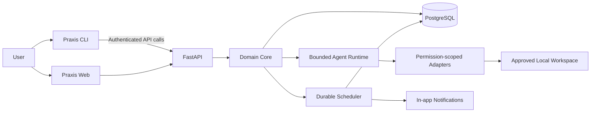

# 03 — System Architecture

## 1. Objective
Build one execution system with two interfaces: a local-first CLI for direct work on selected workspaces, and a web command center for planning and oversight. Neither interface owns separate task logic.

## 2. Context diagram

## 3. Components
- **Web (`apps/web`)**: Today, capture, deadlines, reminders, approvals, execution history, settings. Thin client over the API.
- **API (`services/api`)**: FastAPI boundary for authentication, validation, authorization, use-case coordination, and HTTP contracts.
- **Core (`packages/core`)**: Framework-independent entities, state transitions, use cases, policies, and repository interfaces.
- **CLI (`packages/cli`)**: Typer interface for capture, list, show, status, approvals, and explicit workspace access.
- **Agent runtime (`packages/agent-runtime`)**: Bounded tool-calling loop with allowed-tool lists, budgets, deadlines, stop conditions, and durable checkpoints.
- **Scheduler (`packages/scheduler`)**: Durable reminders and recurring workflows with time-zone handling, idempotency keys, bounded retries, and observable failures.
- **Integrations (`packages/integrations`)**: Narrow, permission-scoped adapters outside domain logic.
- **Persistence**: PostgreSQL stores tasks, commitments, dependencies, reminders, approvals, executions, checkpoints, and audit events.

## 4. Main data flow
1. User captures a commitment through CLI or web.
2. API validates the request and invokes a domain use case.
3. Domain state is persisted before success is acknowledged.
4. Planner proposes a next action and optional reminder.
5. Runtime checks permissions and approval policy before tool use.
6. Checkpoints, action results, and evidence are stored.
7. Both interfaces read the same persisted state.

## 5. Trust boundaries
- Local filesystem access requires explicitly selected workspace roots and canonical-path checks.
- Whole-disk indexing and unrestricted shell execution are disabled by default.
- Sending, deleting, publishing, purchasing, or modifying important remote state requires approval.
- Model-generated plans and arguments are proposals, never authorization.
- Authentication and authorization are enforced server-side.
- Audit records include actor, action, policy decision, approval, result, and evidence without logging unnecessary sensitive content.
- Secrets never belong in prompts, logs, or version control.

## 6. Reliability
Persist before acknowledging capture; use idempotency keys; checkpoint executions; retry only transient failures with limits/backoff; expose exhausted retries for recovery; report uncertainty when completion is not verifiable; recover scheduler state after restarts.

## 7. Deployment
**Local:** web, API, PostgreSQL, and optional queue via Docker Compose. CLI runs on the user's machine and accesses local files only within its approved scope.

**Production:** deploy web/API separately, use managed PostgreSQL and a durable worker/scheduler, isolate secrets, add monitoring, and authenticate CLI sync.

## 8. Decisions
- Shared domain model; no separate CLI/web task logic.
- Local-first filesystem access.
- Deterministic state transitions and scheduling; models assist with interpretation and bounded planning.
- Human approval for consequential actions.
- Begin with a modular monolith; split services only when evidence justifies it.

## 9. Open decisions
Queue/scheduler technology; CLI/API authentication; model-provider abstraction and data policy; migration tooling and audit retention; CLI packaging and updates; offline sync conflict behavior.

## 10. Implementation order
1. Domain entities and task transitions
2. Database schema and migrations
3. FastAPI task endpoints and tests
4. CLI capture/list/show/status
5. Minimal web Today view and capture
6. Reminder scheduling and in-app notifications
7. Approvals, audit events, and bounded agent runtime
8. One narrow administrative workflow
