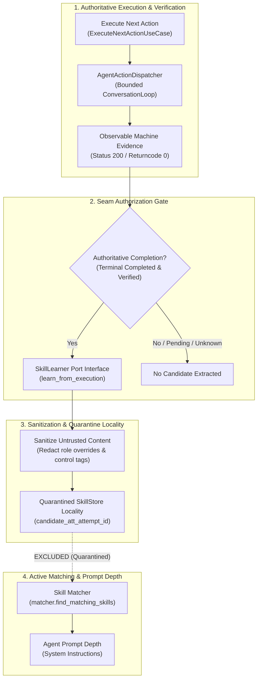

# Milestone M7: Verified Skill Learning Loop

## 1. Overview

Milestone M7 introduces the verified learning loop to Praxis, completing the cycle from execution to reusable procedural knowledge. It connects verified execution completion to candidate procedural distillation while enforcing strict candidate quarantine across the validation seam.

The core promise of M7 is **untrusted candidate quarantine**: procedural skills extracted from execution runs remain unpromoted candidates on disk. Untrusted task descriptions, tool parameters, and tool outputs can never convert into active instructions or gain execution privileges without explicit operator evaluation.

---

## 2. Architecture & Seam Separation

### Key Modules:
- **Port Interface**: [`SkillLearner`](file:///Users/abi/Developer/praxis/packages/core/src/praxis_core/ports/skill_learner.py) defines the decoupled contract for candidate extraction.
- **Runtime Adapter**: [`AgentSkillLearner`](file:///Users/abi/Developer/praxis/packages/agent-runtime/src/praxis_agent_runtime/learning/learning_loop.py) coordinates run evaluation, sanitization, and candidate creation.
- **Execution Hook**: [`ExecuteNextActionUseCase`](file:///Users/abi/Developer/praxis/packages/core/src/praxis_core/use_cases/execute_next_action.py) invokes candidate learning strictly upon verified completion.
- **Candidate Locality**: [`SkillStore`](file:///Users/abi/Developer/praxis/packages/agent-runtime/src/praxis_agent_runtime/skills/skill_store.py) manages isolated candidate files on disk under tenant directory locality.
- **Depth Protection**: [`matcher.py`](file:///Users/abi/Developer/praxis/packages/agent-runtime/src/praxis_agent_runtime/skills/matcher.py) excludes candidates from prompt depth during skill selection.

---

## 3. Security & Operational Invariants

1. **Authoritative Execution Trigger**: Extraction runs only when an attempt reaches terminal `completed` status with verified machine evidence. Interrupted, timed-out, pending, failed, or `outcome_unknown` runs never trigger learning.
2. **Deterministic Idempotency**: Candidate files use deterministic identifiers derived from the source execution attempt (`candidate_att_{attempt_id[:12]}`). Retries or duplicate evaluations never create duplicate candidates.
3. **Strict Candidate Quarantine**: Unvalidated candidates are stored with `is_candidate: true` and excluded from active keyword matching.
4. **Untrusted Input Sanitization**: Prompt injection tags (`<system>`, `<tool_call>`, `<control>`), markdown code block breakouts, and role override directives are stripped or redacted.
5. **Provenance Integrity**: Every candidate record maintains provenance attributes: source attempt ID, task ID, tenant owner ID, and verified evidence hash.
6. **Zero Side-Effect Replay**: Skill extraction is a pure local distillation step that never issues network requests or mutates external targets.

---

## 4. Verification Evidence

The implementation is verified through unit, adversarial, and integration suites:

- **Adversarial & Unit Suite**: [`test_m7_skill_learning.py`](file:///Users/abi/Developer/praxis/packages/agent-runtime/tests/test_m7_skill_learning.py)
  - `test_unverified_execution_does_not_trigger_learning`
  - `test_failed_execution_does_not_trigger_learning`
  - `test_insufficient_steps_does_not_trigger_learning`
  - `test_prompt_injection_sanitization`
  - `test_idempotent_candidate_persistence`
  - `test_candidate_quarantine_in_matcher`
  - `test_candidate_provenance_and_tenant_locality`
  - `test_candidate_explicit_promotion`
- **End-to-End Integration Suite**: [`test_m7_integration.py`](file:///Users/abi/Developer/praxis/services/api/tests/test_m7_integration.py)
  - Exercises full HTTP dispatch → agent runtime execution → machine evidence synthesis → quarantined candidate creation.

All 295 backend tests pass cleanly.
