# Milestone M8: Skills Library UI & Management

## 1. Overview

Milestone M8 completes the procedural knowledge lifecycle initiated in M6 and M7. While M7 produces quarantined procedural knowledge from verified execution runs, M8 provides an authenticated operator with a secure, hardened interface and validation gate to inspect, validate, promote, or reject procedural skills.

The central design principle of M8 is **validated elevation across the security seam**: an untrusted candidate skill cannot enter active execution prompts or runtime tool matching without passing rigorous, multi-layered validation against authoritative execution and evidence records.

---

## 2. Architecture & Enforcement Seams

```mermaid
flowchart TD
  subgraph ClientUI["1. Operator Darkroom Interface (Web UI)"]
    SkillsTab["Skills Library Tab (Keyboard '4')"]
    SubTabs["Candidates | Active Library | Archived"]
    Modals["Promote & Reject Review Modals"]
    SkillsTab --> SubTabs
    SubTabs --> Modals
  end

  subgraph APISeam["2. Fail-Closed API Boundary"]
    AuthGate{"Fail-Closed Auth Verifier<br/>(Bearer Token & Tenant Scope)"}
    Endpoints["GET /skills<br/>GET /skills/{name}<br/>POST /skills/{name}/promote<br/>POST /skills/{name}/reject"]
    Modals --> AuthGate
    AuthGate --> Endpoints
  end

  subgraph ValidationGate["3. Multi-Layer Promotion Validation Gate"]
    AttemptCheck{"Authoritative Attempt Check<br/>(Completed in DB?)"}
    ReceiptCheck{"Evidence Hash Match?<br/>(Receipt verification)"}
    ToolCheck{"Known & Permitted Tools?<br/>(ToolRegistry check)"}
    SafetyCheck{"Safety Constraints?<br/>(Size bounds & injection tags)"}
    Endpoints --> AttemptCheck
    AttemptCheck -- "Yes" --> ReceiptCheck
    ReceiptCheck -- "Yes" --> ToolCheck
    ToolCheck -- "Yes" --> SafetyCheck
  end

  subgraph DurableStorage["4. Hardened Locality Storage (SkillStore)"]
    Locking["Per-Skill Reentrant Lock"]
    AtomicWrite["Atomic Temp File Write (os.replace)"]
    AuditSep["Immutable Provenance + ReviewAudit Record"]
    SafetyCheck -- "Valid" --> Locking
    Locking --> AtomicWrite
    AtomicWrite --> AuditSep
  end

  subgraph ExecutionRuntime["5. Active Agent Runtime Dispatch"]
    RuntimeDispatcher["AgentActionDispatcher"]
    PromptDepth["Active Prompt Depth Matching"]
    AuditSep -. "Promoted (Validated)" .-> RuntimeDispatcher
    RuntimeDispatcher --> PromptDepth
  end
```

---

## 3. Core Security & Lifecycle Invariants

1. **Fail-Closed Operator Authentication**:
   - In production environments, skill management routes require explicit bearer token authentication.
   - Development mode without authentication is strictly restricted to trusted local configurations (`PRAXIS_ENV=development` or `PRAXIS_ALLOW_DEV_NO_AUTH=1`).
   - Mismatched tenant claims between token and request parameters return `403 Forbidden`.
   - Missing or invalid credentials return `401 Unauthorized`.
   - Missing identity never grants permission to access another tenant's skills.

2. **Cross-Tenant Privacy & Information Hiding**:
   - System skills (`owner_id=None`) are shared across tenants in read-only mode.
   - Tenant-authored skills are visible only to the owning tenant (`caller_owner_id == owner_id`).
   - A tenant requesting another tenant's private skill receives a consistent `404 Not Found` error to avoid disclosing its existence.

3. **Collision Rejection & Overwrite Protection**:
   - Skill names normalizing to the same storage slug (e.g. `a b` vs `a@b`) are rejected with `SkillCollisionError` to prevent silent overwrites.
   - Directory traversal attempts are blocked via strict path containment checks.

4. **Multi-Layer Promotion Validation Gate**:
   - The candidate's source execution attempt is verified in the authoritative database and must be in terminal `completed` status with verified evidence.
   - The candidate's evidence hash is cryptographically validated against the authoritative evidence receipt.
   - All tools declared in `required_tools` must be registered and permitted by the runtime `ToolRegistry`.
   - Skill instructions, descriptions, and triggers must adhere to strict size bounds and contain no prompt injection control directives (`<system>`, `<tool_call>`, `<control>`).

5. **Provenance Immutability & Audit Separation**:
   - Original machine execution provenance (`attempt_id`, `evidence_id`, `evidence_hash`) remains strictly immutable.
   - Review decisions are captured separately in a structured `ReviewAudit` record (`decision`, `operator_id`, `timestamp`, `notes`).

6. **Terminal Rejection & Concurrency Safety**:
   - A candidate that has been rejected enters a terminal state and can never be promoted (`409 Conflict`).
   - Concurrent promote/reject requests are serialized using per-skill reentrant locks (`threading.RLock`).
   - All file mutations are performed atomically using temporary files and `os.replace`.

---

## 4. Verification Matrix

The milestone is validated across unit, adversarial, integration, and UI checks:

| Test Area | Suite | Verified Invariants |
|---|---|---|
| Storage Hardening | `test_m8_skills_store.py` | Slug collision rejection, atomic failure preservation, concurrency serialization, terminal rejection, tenant visibility, provenance immutability |
| API & Auth Security | `test_m8_skills_api.py` | Fail-closed auth, cross-tenant 404 isolation, 6-phase promotion validation gate, terminal rejection, extra-field rejection, runtime dispatch matching |
| End-to-End Learning | `test_m7_integration.py` | Multi-step agent dispatch → machine evidence synthesis → quarantined candidate → operator promotion → active matching |
| Frontend UI/UX | `apps/web` (Lint & Build) | Editorial Darkroom aesthetics, keyboard shortcut `4`, candidates/active/archived tabs, modal validation, zero optimistic state corruption |

All 311 backend tests pass, ruff checks pass, `git diff --check` passes, and Next.js production build compiles cleanly.
